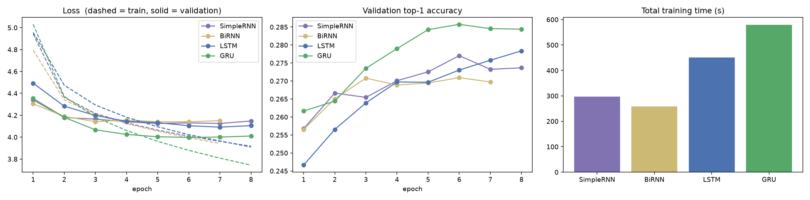
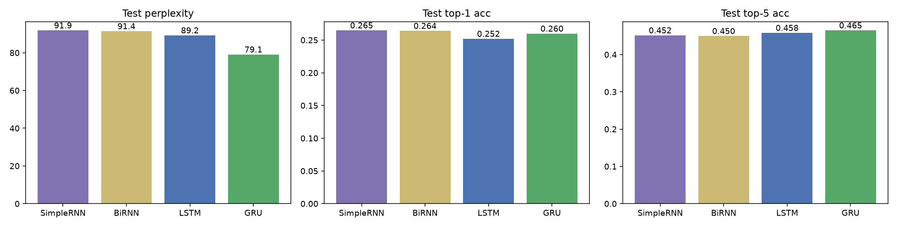
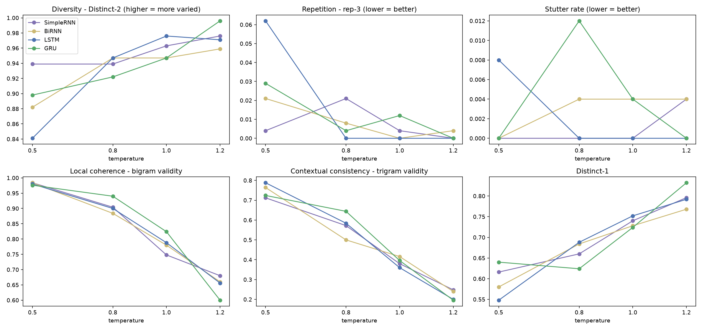

# Autoregressive Text Generation on Tiny Shakespeare: SimpleRNN vs BiRNN vs LSTM vs GRU

Foundations of Generative AI (ICT4403) - Assignment 2

## 1. Problem statement and objective
Build a word-level **autoregressive language model** that predicts the next word from the previous 10 words and generates text one word at a time. Train four recurrent architectures (**SimpleRNN, Bidirectional RNN, LSTM, GRU**) under identical conditions, compare them quantitatively (loss, perplexity, accuracy, training time) and qualitatively (coherence, diversity, contextual consistency, repetition), study the effect of **sampling temperature** (0.5, 0.8, 1.0, 1.2), and identify the best model.

## 2. Dataset
* **Name:** Tiny Shakespeare (Andrej Karpathy, `char-rnn`)
* **Source link:** https://raw.githubusercontent.com/karpathy/char-rnn/master/data/tinyshakespeare/input.txt
* **Content:** ~1.1 MB (1,115,394 characters, 40,000 lines, ~202k words) of dialogue from several Shakespeare plays: speaker labels, verse lines, archaic vocabulary, Zipfian word distribution.
* **Pre-processing:** lower-casing; tokenisation into words (keeping inner apostrophes), punctuation marks (`. , ! ? ; : -`) and a newline token; blank lines collapsed; vocabulary = 3,000 most frequent tokens (`<pad>`, `<unk>` included; 94.2 % token coverage).
* **Sequences:** sliding window (stride 1) of 11 tokens: 10 input tokens -> 1 target (next token). 284,809 sequences, split chronologically 90/5/5 into 256,328 train / 14,240 validation / 14,241 test.
* Plots: `results/dataset_characteristics.png`

## 3. Models
All share `Embedding(3000, 64) -> recurrent layer -> Dropout(0.3) -> Dense(3000, softmax)`.

| Model | Recurrent layer | Parameters |
|---|---|---|
| SimpleRNN | `SimpleRNN(128)` | 603,704 |
| BiRNN | `Bidirectional(SimpleRNN(64))` (128 total dims) | 595,512 |
| LSTM | `LSTM(128)` | 677,816 |
| GRU | `GRU(128)` | 653,496 |

Common training setup: Adam (lr 2e-3, grad-clip 1.0), sparse categorical cross-entropy, batch 256, max 8 epochs, early stopping (patience 2 on validation loss, best weights restored), seed 42, identical splits.

## 4. Repository structure
```
.
|-- Autoregressive_Text_Generation.ipynb   # full implementation with outputs
|-- Autoregressive_Text_Generation.py      # same code as a script
|-- requirements.txt
|-- data/tinyshakespeare.txt               # dataset copy (source link above)
|-- models/                                # trained .keras models
`-- results/                               # csv tables, plots, histories, generated samples
```

## 5. Execution steps and dependencies
```bash
pip install -r requirements.txt
jupyter notebook Autoregressive_Text_Generation.ipynb   # run all cells
# or
python Autoregressive_Text_Generation.py
```
Tested with Python 3.12 and TensorFlow 2.21 (Keras 3) on a single CPU core; full training takes roughly 30 minutes. The notebook resumes from `results/ckpt_*.json` + `models/*.keras` if present (delete them to retrain from scratch). Downloading the dataset happens automatically if `data/tinyshakespeare.txt` is missing.

## 6. Results
### Quantitative results (test set unless stated)
| Model | Params | Epochs run | Best epoch | Train loss (final) | Val loss (best) | Test loss | Val perplexity | Test perplexity | Test top-1 acc | Test top-5 acc | Train time (s) | Sec / epoch |
|---|---|---|---|---|---|---|---|---|---|---|---|---|
| SimpleRNN | 603,704 | 8 | 7 | 3.918 | 4.125 | 4.520 | 61.9 | 91.9 | 26.48 % | 45.16 % | 297.7 | 37.2 |
| BiRNN | 595,512 | 7 | 5 | 3.943 | 4.141 | 4.516 | 62.8 | 91.4 | 26.41 % | 44.98 % | 258.2 | 36.9 |
| LSTM | 677,816 | 8 | 7 | 3.910 | 4.092 | 4.491 | 59.8 | 89.2 | 25.20 % | 45.83 % | 451.0 | 56.4 |
| GRU | 653,496 | 8 | 6 | 3.745 | 3.998 | 4.371 | 54.5 | 79.1 | 25.99 % | 46.49 % | 580.0 | 72.5 |




### Generation metrics by model and temperature
5 seeds x 50 generated words per cell. Distinct-1/2 = diversity; rep-3 and stutter = repetition; bigram/trigram validity = share of generated n-grams that occur in the training text (proxies for local coherence / contextual consistency).

| Model | T | distinct1 | distinct2 | rep3 | stutter | bigram_validity | trigram_validity |
|---|---|---|---|---|---|---|---|
| BiRNN | 0.5 | 0.580 | 0.882 | 0.021 | 0.000 | 0.984 | 0.764 |
| BiRNN | 0.8 | 0.684 | 0.947 | 0.008 | 0.004 | 0.884 | 0.500 |
| BiRNN | 1.0 | 0.728 | 0.947 | 0.000 | 0.004 | 0.780 | 0.416 |
| BiRNN | 1.2 | 0.768 | 0.959 | 0.004 | 0.004 | 0.660 | 0.240 |
| GRU | 0.5 | 0.640 | 0.898 | 0.029 | 0.000 | 0.976 | 0.724 |
| GRU | 0.8 | 0.624 | 0.922 | 0.004 | 0.012 | 0.940 | 0.644 |
| GRU | 1.0 | 0.724 | 0.947 | 0.012 | 0.004 | 0.824 | 0.396 |
| GRU | 1.2 | 0.832 | 0.996 | 0.000 | 0.000 | 0.600 | 0.196 |
| LSTM | 0.5 | 0.548 | 0.841 | 0.062 | 0.008 | 0.980 | 0.788 |
| LSTM | 0.8 | 0.688 | 0.947 | 0.000 | 0.000 | 0.900 | 0.584 |
| LSTM | 1.0 | 0.752 | 0.976 | 0.000 | 0.000 | 0.788 | 0.360 |
| LSTM | 1.2 | 0.792 | 0.971 | 0.000 | 0.000 | 0.656 | 0.200 |
| SimpleRNN | 0.5 | 0.616 | 0.939 | 0.004 | 0.000 | 0.984 | 0.712 |
| SimpleRNN | 0.8 | 0.660 | 0.939 | 0.021 | 0.000 | 0.904 | 0.572 |
| SimpleRNN | 1.0 | 0.740 | 0.963 | 0.004 | 0.000 | 0.748 | 0.380 |
| SimpleRNN | 1.2 | 0.796 | 0.976 | 0.000 | 0.004 | 0.680 | 0.248 |



All 80 generated samples (4 models x 4 temperatures x 5 seeds): [`results/generated_samples.md`](results/generated_samples.md). Seeds are listed there.

### Composite ranking (mean rank over 7 criteria, generation criteria at T = 0.8; 1 = best)
| Model | Test perplexity (low) | Test top-5 acc (high) | Train time (low) | Bigram validity (high) | Trigram validity (high) | Distinct-2 (high) | Rep-3 (low) | Mean rank |
|---|---|---|---|---|---|---|---|---|
| BiRNN | 3.00 | 4.00 | 1.00 | 4.00 | 4.00 | 1.50 | 3.00 | 2.93 |
| GRU | 1.00 | 1.00 | 4.00 | 1.00 | 1.00 | 4.00 | 2.00 | 2.00 |
| LSTM | 2.00 | 2.00 | 3.00 | 3.00 | 2.00 | 1.50 | 1.00 | 2.07 |
| SimpleRNN | 4.00 | 3.00 | 2.00 | 2.00 | 3.00 | 3.00 | 4.00 | 3.00 |

## Analysis and Conclusion

### 1 Model comparison (Task ii)
All four models were trained with identical data, seed, optimiser, batch size, epoch budget and early-stopping rule (single run each, seed 42).

| Model | Test perplexity | Test top-1 | Test top-5 | Train time (s) |
|---|---|---|---|---|
| SimpleRNN | 91.9 | **26.5 %** | 45.2 % | 298 |
| BiRNN | 91.4 | 26.4 % | 45.0 % | **258** |
| LSTM | 89.2 | 25.2 % | 45.8 % | 451 |
| GRU | **79.1** | 26.0 % | **46.5 %** | 580 |

* **Loss / perplexity.** GRU is clearly best (test loss 4.371, perplexity 79.1, about 11 % lower than LSTM's 89.2). LSTM, BiRNN and SimpleRNN are close to each other (89-92). Test loss is higher than validation loss for every model because the chronologically last 5 % of the corpus comes from different plays than the text seen in training (distribution shift), not because of a bug.
* **Accuracy.** Top-1 accuracy is nearly flat (25-26.5 %) and SimpleRNN is nominally highest, so top-1 does not separate the models; top-5 accuracy and perplexity, which score the whole predicted distribution, do favour GRU. With one run per model, gaps of ~1 point in accuracy should not be over-interpreted.
* **Training time.** The gated models cost more: GRU 580 s and LSTM 451 s versus 258-298 s for the plain RNNs. GRU being slower than LSTM is probably an artefact of Keras' CPU implementation on a shared single core (SimpleRNN epochs alone ranged 25-41 s), so timings are indicative only. BiRNN stopped after 7 epochs (early stopping); the others ran all 8.
* **Bidirectional RNN.** It gave no real benefit over SimpleRNN. This is expected: generation is strictly left-to-right, and reading the already-known 10-word window backwards adds little.
* **Qualitative.** At T = 0.5 all models fall into stock loops: repeated speaker labels (`duke vincentio:` several times in one sample), filler like "i have heard" / "i know not", and occasional stutters such as "i know not not" (LSTM). At T = 0.8 outputs look like Shakespeare-shaped text - speaker labels, line breaks, archaic phrasing - and are mostly locally grammatical, but none sustains a topic or an argument, and none stays on the seed's subject. This is the expected ceiling of a 10-word context window and a ~1 MB corpus.

### 2 Influence of sampling temperature (Task iii)
Means over 5 seeds x 50 words per model and temperature (so each cell is only 250 generated words; small differences are noise).

| Trend as T rises 0.5 -> 1.2 | Observation |
|---|---|
| **Coherence** (bigram validity) | falls for every model, from about 0.98 to 0.60-0.68; trigram validity falls from 0.71-0.79 to 0.20-0.25 |
| **Diversity** (distinct-2) | rises from 0.84-0.94 to 0.96-0.996; distinct-1 from 0.55-0.64 to 0.77-0.83 |
| **Repetition** (rep-3, stutter) | highest at T = 0.5 for LSTM (0.062), GRU (0.029) and BiRNN (0.021); SimpleRNN is non-monotonic (peak 0.021 at T = 0.8). At T >= 1.0 all values are <= 0.012. All values are small, so differences are within noise |

* **T = 0.5 - safe but dull.** Almost every bigram is real Shakespeare-corpus text (about 0.98), but output is repetitive and generic, and trigram validity (0.71-0.79) shows it often reproduces common corpus phrases.
* **T = 0.8 - best trade-off.** Repetition is nearly gone and diversity is high (distinct-2 about 0.92-0.95), while coherence is still reasonable (bigram validity 0.88-0.94).
* **T = 1.0 - transition.** Bigram validity drops to 0.75-0.82; rare words and broken grammar start to appear.
* **T = 1.2 - incoherent.** Highest diversity but text degrades into word salad ("party image the good souls worthy are he fond of wrongs ..."), with bigram validity of only 0.60-0.68. The diversity is partly the model sampling its low-probability tail, not creativity.

### 3 Best model
**GRU is the most effective autoregressive generator on this dataset**, with the caveats below:
* lowest test loss and perplexity (79.1 vs 89-92) and the best top-5 accuracy;
* at the balanced T = 0.8 it has the highest bigram validity (0.940 vs 0.884-0.904) and trigram validity (0.644 vs 0.500-0.584) with repetition near zero (rep-3 0.004). Its distinct-2 (0.922) is slightly lower than the others (0.939-0.947) - the flip side of staying closer to valid corpus text;
* it has the best mean rank in the composite ranking (2.00), narrowly ahead of LSTM (2.07), BiRNN (2.93) and SimpleRNN (3.00).

**Caveats.** The composite lead over LSTM is small and depends on the chosen criteria and equal weights; GRU is also the slowest to train here. Results come from a single training run and 5 seeds, the coherence/consistency measures are proxies (n-gram validity against the training corpus), and the generated text, while stylistically Shakespearean, is not semantically coherent for any model. If training cost were the main concern, SimpleRNN/BiRNN give about 15 % higher perplexity at roughly half the training time. Natural next steps would be a longer context, several random seeds with confidence intervals, and a larger corpus or a Transformer baseline.

# ICT4403-FGAI-Assignment-2.

